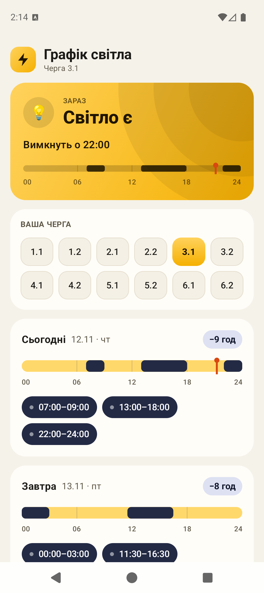
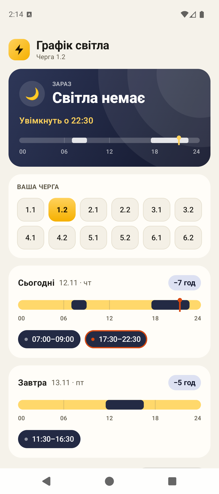
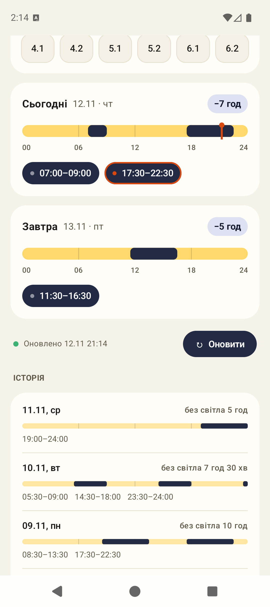
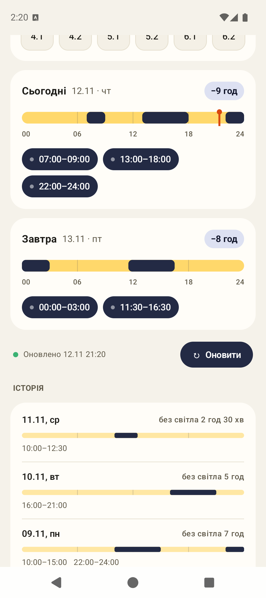
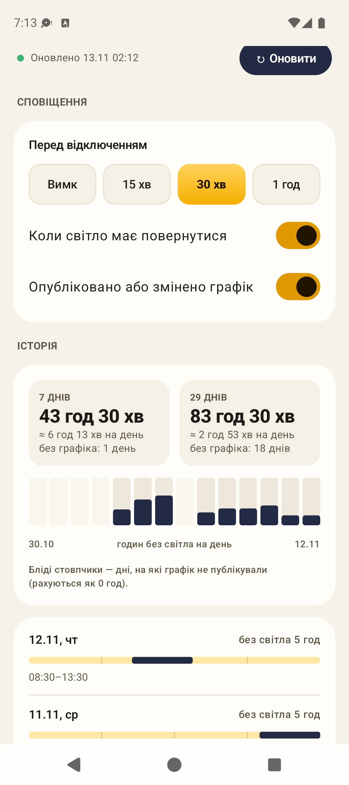
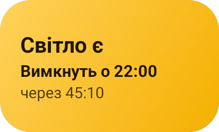
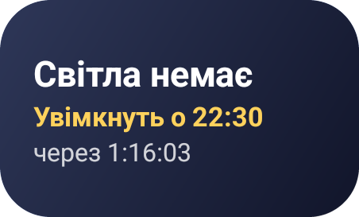
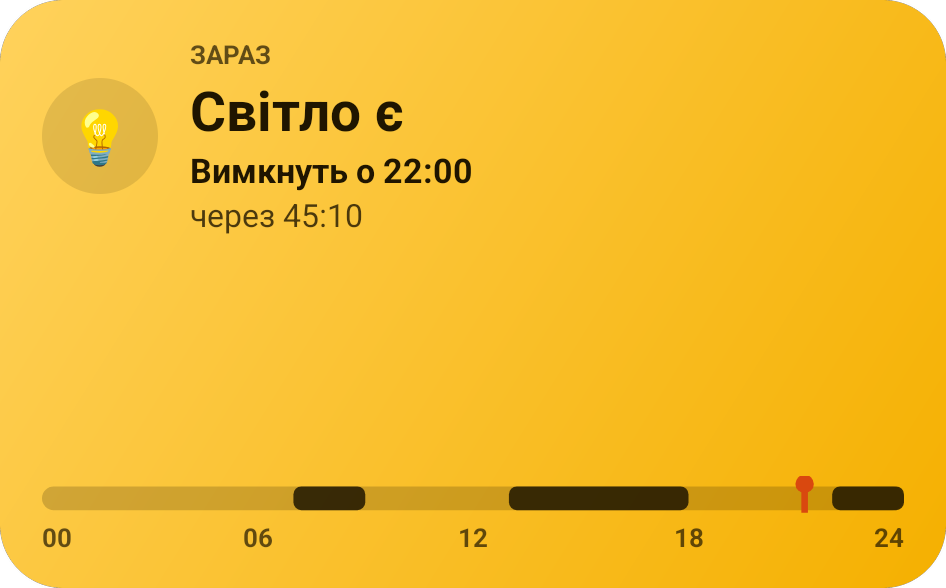
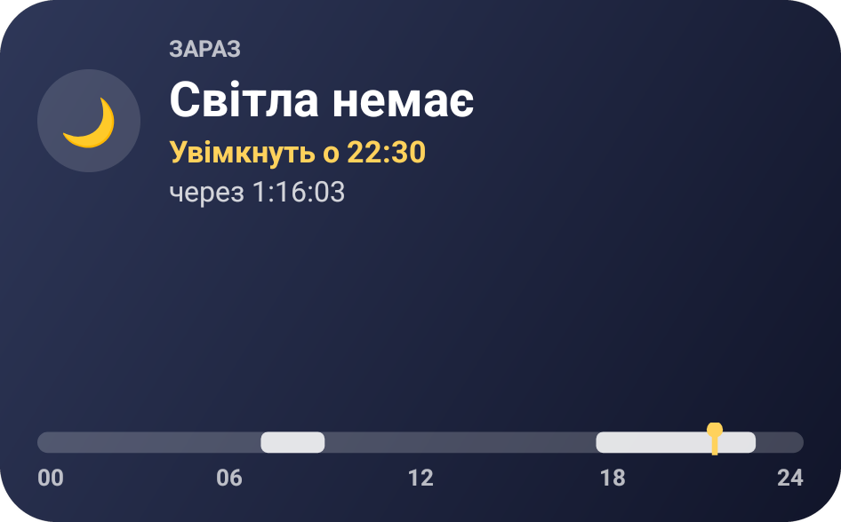

# Чи є світло · echecker

**[English](#english) · [Українська](#українська)** · **[⬇ APK](https://github.com/iridiscenthummingbird/echecker/releases/latest/download/echecker.apk)**

<p align="center">
  
  &nbsp;
  
  &nbsp;
  
</p>

---

## English

**echecker** («Чи є світло», *"Is there power?"*) is an Android app with a home-screen widget that tells you whether your
building has electricity right now, according to the scheduled power outage plan for the **Zaporizhzhia region**.

You pick your outage queue once (1.1 … 6.2). After that the app and the widget show:

- **the current status:** *Power is on* or *No power*;
- **when it changes next:** "turns off at 22:00" or "turns on at 22:30", with a live countdown;
- **a 24-hour timeline** for today with a "now" marker;
- **tomorrow's schedule** once it is published;
- **history:** past days' schedules for your queue, plus hours without power over 7 and 30 days, the daily average and
  a 14-day chart.

**Notifications** (each can be turned off in the app):

- a warning before an outage: 15 min, 30 min or 1 h ahead (30 min by default);
- when power should be back;
- when today's or tomorrow's schedule is published or changes for your queue.

Schedules come from the public Telegram channel [t.me/zoe_alarm](https://t.me/zoe_alarm). The app reads its public web
preview, so you don't need a Telegram account, an API key or a server. If zoe_alarm is unavailable or leaves a gap, the
app falls back to [t.me/Zaporizhzhyaoblenergo_news](https://t.me/Zaporizhzhyaoblenergo_news) and
[zoe.com.ua](https://www.zoe.com.ua/); zoe_alarm data always wins. Data refreshes in the background every 30 minutes
(catching up on everything posted while the phone was offline), whenever the app is opened, and when you tap
**Refresh**. If an update fails, the reason is shown under the button. Everything is cached locally, so the app and
the widget also work offline.

The app is in **Ukrainian** or **English**, following the phone's language; on Android 13+ you can pick the app's
language in system settings. It works with **TalkBack**.

### Download

**[⬇ Download the latest APK](https://github.com/iridiscenthummingbird/echecker/releases/latest/download/echecker.apk)** · [all releases](https://github.com/iridiscenthummingbird/echecker/releases)

Open the file on your phone and allow installs from this source when Android asks. Android 8.0 or newer is required.
**Updates:** from v1.1 on, the app checks GitHub for new releases twice a day and whenever you open it. When one is out, you get a notification and an **Update** button on the main screen. It downloads the APK and opens the system installer, and your queue and history are kept. The first time, Android asks you to allow installs from the app. On v1.0, download the APK above once more by hand.

> If you installed an earlier build that was not from Releases, uninstall it first. It was signed with a different key,
> so Android will refuse to install the new APK over it.

### Screenshots

The app on a Pixel 9 using the real schedule for 12.11. Queue **3.1** has power and queue **1.2** is in an outage.

| | Power is on (queue 3.1) | No power (queue 1.2) |
|---|:---:|:---:|
| **App** |  |  |
| **History** |  |  |

Notification settings and history stats (7 / 30 days, daily average, 14-day chart; faint bars are days with no
published schedule):

<p align="center"></p>

### Widget

The widget can be resized, and its layout adapts to the size:

- **2×1:** the status, the next change and a countdown.
- **4×1:** the same, plus a status icon.
- **4×2:** the same, plus a "NOW" label and a timeline of today's outages.

Tapping the widget opens the app. It flips status exactly when an outage starts or ends.

A second widget, **"Power: another queue"**, asks for a queue when you add it and shows that queue regardless of the
one selected in the app — handy for your parents' or your work address. Its queue can be changed later.

| Size | Power is on (queue 3.1) | No power (queue 1.2) |
|---|:---:|:---:|
| **2×1** |  |  |
| **4×1** |  |  |
| **4×2** |  |  |

### Tech stack

Kotlin · Jetpack Compose (UI) · Jetpack Glance (widget) · WorkManager · Room · DataStore · OkHttp · Jsoup.
Requires Android 8.0+ (minSdk 26, targetSdk 36).

### Build

```bash
./gradlew assembleDebug      # APK → app/build/outputs/apk/debug/
./gradlew installDebug       # install on a connected device / emulator
./gradlew testDebugUnitTest  # unit tests (parser, status, sync, migrations, translations)
./gradlew assembleRelease    # minified (R8) release APK; signed if the keystore properties are set
```

Requires JDK 17 and the Android SDK. Room schemas for every database version are kept in `app/schemas/`; add a
migration and a test in `MigrationTest` whenever the schema changes. Every string in `values/strings.xml` (Ukrainian)
needs an English counterpart in `values-en/strings.xml` — a test checks it.

### Limitations

- The app shows **scheduled** outages only. It cannot detect actual ones.
- Cancellations ("ГПВ … скасовано", "не застосовуватимуться") and partial updates ("для решти черг без змін", "лише для черги 3.2") are recognised by their wording. The channel has not published such posts yet, so unusual phrasings may still be missed.
- If Telegram changes the layout of its web preview, `ChannelFetcher` has to be updated.
- The zoe.com.ua backup reads the site's WordPress API; the site is only reachable from Ukraine, so this source has
  not been tested live.
- In the statistics, a day with no published schedule counts as a day without outages.

---

## Українська

**Чи є світло** (echecker) — це Android-застосунок із віджетом для домашнього екрана. Він показує, чи є зараз світло у
вашому будинку, за графіком погодинних відключень **Запорізької області**.

Один раз оберіть свою чергу (1.1 … 6.2), і далі застосунок та віджет показуватимуть:

- **поточний стан:** «Світло є» або «Світла немає»;
- **коли буде наступна зміна:** «Вимкнуть о 22:00» чи «Увімкнуть о 22:30», із живим зворотним відліком;
- **шкалу на 24 години** на сьогодні з позначкою «зараз»;
- **графік на завтра**, коли його опублікують;
- **історію:** графіки вашої черги за минулі дні, а також години без світла за 7 і 30 днів, середнє на день і
  діаграму за 14 днів.

**Сповіщення** (кожне можна вимкнути в застосунку):

- попередження перед відключенням: за 15 хв, 30 хв або 1 год (за замовчуванням — за 30 хв);
- коли світло має повернутися;
- коли графік на сьогодні чи завтра опублікували або він змінився для вашої черги.

Графіки беруться з публічного Telegram-каналу [t.me/zoe_alarm](https://t.me/zoe_alarm). Застосунок читає його
публічну веб-версію, тому не потрібні ні акаунт у Telegram, ні API-ключ, ні сервер. Якщо zoe_alarm недоступний або
в ньому бракує графіка, застосунок бере дані з резервних джерел:
[t.me/Zaporizhzhyaoblenergo_news](https://t.me/Zaporizhzhyaoblenergo_news) і [zoe.com.ua](https://www.zoe.com.ua/);
дані zoe_alarm завжди мають пріоритет. Дані оновлюються у фоні кожні 30 хвилин (із підтягуванням усього, що вийшло,
поки телефон був офлайн), щоразу під час відкриття застосунку і після натискання кнопки **Оновити**. Якщо оновлення
не вдалося, причину видно під кнопкою. Усе зберігається локально, тож застосунок і віджет працюють навіть без інтернету.

Застосунок працює **українською** або **англійською** — за мовою телефону; на Android 13+ мову застосунку можна
обрати в налаштуваннях системи. Підтримується **TalkBack**.

### Завантажити

**[⬇ Завантажити останній APK](https://github.com/iridiscenthummingbird/echecker/releases/latest/download/echecker.apk)** · [усі релізи](https://github.com/iridiscenthummingbird/echecker/releases)

Відкрийте файл на телефоні та дозвольте встановлення з цього джерела, коли Android запитає. Потрібен Android 8.0 або новіший.
**Оновлення:** починаючи з v1.1, застосунок сам перевіряє нові релізи на GitHub двічі на добу і щоразу під час відкриття. Коли виходить нова версія, приходить сповіщення, а на головному екрані з'являється кнопка **Оновити**. Вона завантажує APK і відкриває системний інсталятор, черга та історія зберігаються. Першого разу Android попросить дозволити встановлення з цього застосунку. З v1.0 ще раз завантажте APK за посиланням вище вручну.

> Якщо у вас стоїть старіша збірка не з Releases, спершу видаліть її. Вона підписана іншим ключем, тому Android
> не дасть встановити новий APK поверх неї.

### Скріншоти

Застосунок на Pixel 9 з реальним графіком на 12.11. У черзі **3.1** світло є, у черзі **1.2** — відключення.

| | Світло є (черга 3.1) | Світла немає (черга 1.2) |
|---|:---:|:---:|
| **Застосунок** |  |  |
| **Історія** |  |  |

Налаштування сповіщень і статистика історії (7 / 30 днів, середнє на день, діаграма за 14 днів; бліді стовпчики —
дні, на які графік не публікували):

<p align="center"></p>

### Віджет

Розмір віджета можна змінювати, і вміст підлаштовується під нього:

- **2×1:** стан, час наступної зміни та відлік.
- **4×1:** те саме плюс іконка стану.
- **4×2:** те саме плюс підпис «ЗАРАЗ» і шкала сьогоднішніх відключень.

Натискання на віджет відкриває застосунок. Стан на віджеті змінюється точно в момент початку чи кінця відключення.

Другий віджет, **«Світло: інша черга»**, під час додавання просить обрати чергу і показує її незалежно від черги в
застосунку — зручно для батьків чи роботи. Чергу можна змінити пізніше.

| Розмір | Світло є (черга 3.1) | Світла немає (черга 1.2) |
|---|:---:|:---:|
| **2×1** |  |  |
| **4×1** |  |  |
| **4×2** |  |  |

### Технології

Kotlin · Jetpack Compose (UI) · Jetpack Glance (віджет) · WorkManager · Room · DataStore · OkHttp · Jsoup.
Потрібен Android 8.0+ (minSdk 26, targetSdk 36).

### Збірка

```bash
./gradlew assembleDebug      # APK → app/build/outputs/apk/debug/
./gradlew installDebug       # встановити на підключений пристрій / емулятор
./gradlew testDebugUnitTest  # юніт-тести (парсер, статус, синхронізація, міграції, переклади)
./gradlew assembleRelease    # мініфікований (R8) release-APK; підписується, якщо задано властивості ключа
```

Потрібні JDK 17 та Android SDK. Схеми Room для кожної версії бази лежать у `app/schemas/`; при зміні схеми додайте
міграцію і тест у `MigrationTest`. Кожен рядок у `values/strings.xml` (українська) потребує англійського відповідника
у `values-en/strings.xml` — це перевіряє тест.

### Обмеження

- Застосунок показує лише **заплановані** відключення. Фактичних він не бачить.
- Скасування («ГПВ … скасовано», «не застосовуватимуться») і часткові оновлення («для решти черг без змін», «лише для черги 3.2») розпізнаються за формулюваннями. Канал таких постів ще не публікував, тож незвичні формулювання можуть бути пропущені.
- Якщо Telegram змінить верстку веб-версії каналу, доведеться оновити `ChannelFetcher`.
- Резервне джерело zoe.com.ua читає WordPress API сайту; сайт відкривається лише з України, тож це джерело не
  перевірене наживо.
- У статистиці день без опублікованого графіка рахується як день без відключень.
